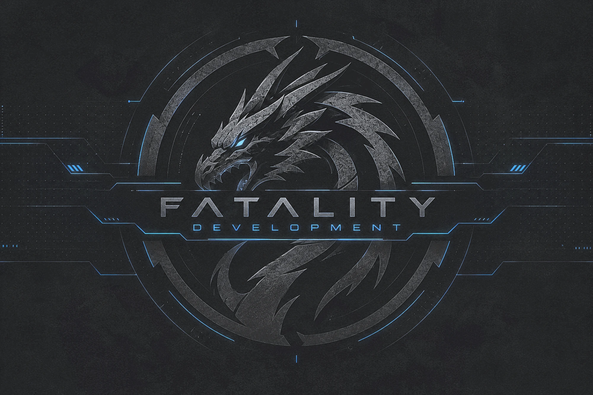

No custom firmware needed. 



# SOCOM II Multiplayer

A private online server for SOCOM U.S. Navy SEALs II (PS2) in a single container. It runs:

| Service | Port | Purpose |
|---|---|---|
| DNS | 53/udp | The PS2's primary DNS. Answers `*.dnas.playstation.org` and `*.pdonline.scea.com` with this server's IP |
| Patch HTTP | 80/tcp | Serves `APACHE00.ZDB` (r0004 patch) to unpatched consoles |
| DNAS | 443/tcp | Live DNAS authentication for unmodified retail discs (code in `Dnas/`, from [DnaSDK](https://github.com/FatalityDevelopment/DnaSDK)) |
| NAT | 10069/udp | NAT helper |
| DME | 10070/tcp | Game worlds |
| MUIS | 10071/tcp | Universe list, news, patch announcement |
| MLS | 10075/tcp | Lobby, chat, clans, stats |
| MAS | 10077/tcp | Account login |

The server came from `CodeDesigner.Ps2.Multiplayer` in [CodeDesignerPS2](https://github.com/FatalityDevelopment/CodeDesignerPS2).
It keeps the same project name and namespaces, so changes can be copied between the two repos.

## Run it (Docker)

```bash
SERVER_IP=192.168.1.20 docker compose up --build -d
```

Set `SERVER_IP` to the address the PS2 can reach, usually this machine's LAN IP. You can also put
`SERVER_IP=...` in a `.env` file next to `docker-compose.yml`. On the PS2, set **Primary DNS** to that IP.
DNS points the console at everything else.

### Using someone else's DNAS server

To send consoles to an external DNAS server, such as a friend's public one, set `EXTERNAL_DNAS` to its IP or
hostname:

```bash
SERVER_IP=192.168.1.20 EXTERNAL_DNAS=dnas.example.org docker compose up --build -d
```

The built-in DNAS gateway then stays off. DNS answers `*.dnas.playstation.org` with the external server's
address (a hostname is re-resolved every minute). Medius names still point at `SERVER_IP`, so consoles
authenticate with the external DNAS server and play on this one. Outside compose, the setting is
`Online__ExternalDnasServer`; on Azure it's `-ExternalDnasServer`.

Logs: `docker compose logs -f`. Set `LOG_LEVEL=Debug` to log full packet hex.

Ports 53, 80 and 443 must be free on the host. On Linux, `systemd-resolved` often holds 53. On Windows,
IIS or another web server may hold 80 or 443.

### Persistent data (`/data` volume)

| Path | Contents |
|---|---|
| `server-data.json`, `bans.json`, `cheat-scan.json` | Accounts, stats, friends, clans, bans |
| `dnas/RSA/Signatures/<SERIAL>.BIN` | DNAS tickets, cached the first time a title logs in |
| `dnas/PacketLogs/` | DnaSDK's per-session DNAS request/response captures |
| `patch/APACHE00.ZDB` | The patch file to serve. Copy it in yourself; it is not in this repo |

To copy the patch file into the volume:

```bash
docker compose cp APACHE00.ZDB socom2-server:/data/patch/APACHE00.ZDB
```

## Configuration

Settings come from `CodeDesigner.Ps2.Multiplayer/config.json`. Environment variables named `Online__<Setting>`
override them, and so does an extra JSON file named by `MULTIPLAYER_CONFIG`. The container defaults are:

| Variable | Default | Notes |
|---|---|---|
| `Online__ServerIp` | `auto` | The IP announced to consoles. `auto` resolves `Online__PublicHostname`, or falls back to a public-IP lookup |
| `Online__DnsForwardUnknown` | `false` | `true` forwards other DNS names upstream (compose turns this on for LAN use). Keep it `false` on a public IP |
| `Online__DataDirectory` | `/data` | |
| `MULTIPLAYER_LOG_FILE` | `none` | Logs go to stdout only |

DNAS settings (all optional):

| Setting | Default |
|---|---|
| `ExternalDnasServer` | Empty. Set an IP or hostname to use another DNAS server; the built-in one then stays off |
| `DnasHttpsPort` | `443` (`0` disables DNAS) |
| `DnasRegion` | `us-gw`. Picks the certificate (`us-gw` → `cert-us`, `eu-gw` → `cert-eu`, `gai-gw` → `cert-jp`) and the packet region searched first |
| `DnasCertPath` / `DnasKeyPath` | `Certificates/dnas.crt` + `dnas.key` if present, otherwise the `DnasRegion` certificate |
| `DnasCaPath` | `Certificates/ca-cert.pem` |
| `DnasRsaDirectory` | `<DataDirectory>/dnas/RSA` |
| `DnasCaptureDirectory` | `<DataDirectory>/dnas/PacketLogs` |
| `DnasRepositoryUrl` | `Data`. The captured packets (`<region>/packets/<lookup>_<operation>`) each title's original RSA ticket is taken from. Can also be an HTTPS DNASrep mirror |

The DNAS code doesn't replay these packets. It runs a live exchange for every session. From a title's captured S1
it takes only the original 128-byte signed ticket, which the retail client checks.

## Cloud deployment

See [deploy/azure/README.md](deploy/azure/README.md). It covers Azure Container Instances, which can expose UDP ports.

## Layout

```
CodeDesigner.Ps2.Multiplayer/   Medius/DME/NAT/DNS/patch server (.NET 10)
  Servers/DnasServer.cs         Starts the DNAS gateway
  Dnas/                         DNAS protocol, TLS and crypto (from DnaSDK); README.md documents the protocol
  Certificates/                 DNAS gateway TLS certificates (per region) + CA
  Data/<region>/packets/        Captured DNAS packets: the source of each title's RSA ticket
deploy/azure/                   ACI bicep + deploy script
Dockerfile, docker-compose.yml
```

### Updating from DnaSDK

DnaSDK's source is part of the server project, not a separate project. It lives in `Dnas/` under one namespace,
`CodeDesigner.Ps2.Multiplayer.Dnas`:

| `Dnas/` folder | Upstream DnaSDK folder |
|---|---|
| `Client/` | `DNAS.Client/` |
| `Cryptography/` | `DNAS.Cryptography/` |
| `Server/` | `DNAS.Server/` |
| `Transport/` | `TCP.Server/` |
| `Tls/` | `TCP.TLS/` |
| `Moduli/` | `Assets/Moduli/` |

To bring in a newer DnaSDK, copy its files into the matching folders and keep these differences:

- Namespaces `DNAS`, `TCP.Server` and `TLS` all become `CodeDesigner.Ps2.Multiplayer.Dnas`. The `using DNAS;`,
  `using TCP.Server;` and `using TLS;` lines are dropped. In `Client/ClientSetup.cs`, `DNAS.Identity` becomes
  `global::CodeDesigner.Ps2.Multiplayer.Dnas.Identity`.
- Upstream's `Program.cs` and `TCP.Server/ServerOptions.cs` (its standalone command-line tool), `Dockerfile`,
  and `TCP.TLS/Certificates/` aren't copied. Certificates come from `Certificates/`.
- `Server/DnasRepRepository.cs` reads a local packet folder as well as HTTPS, and searches a preferred region first.

## Building without Docker

```bash
dotnet build Socom2Multiplayer.slnx
dotnet run --project CodeDesigner.Ps2.Multiplayer
```

This needs the .NET 10 SDK. Binding ports 53, 80 and 443 needs admin/root.
